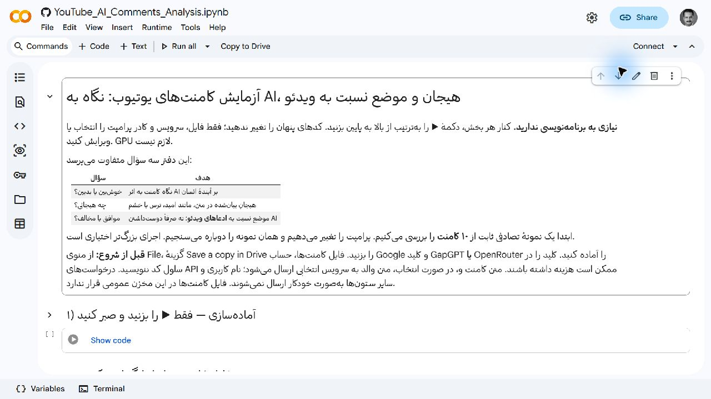
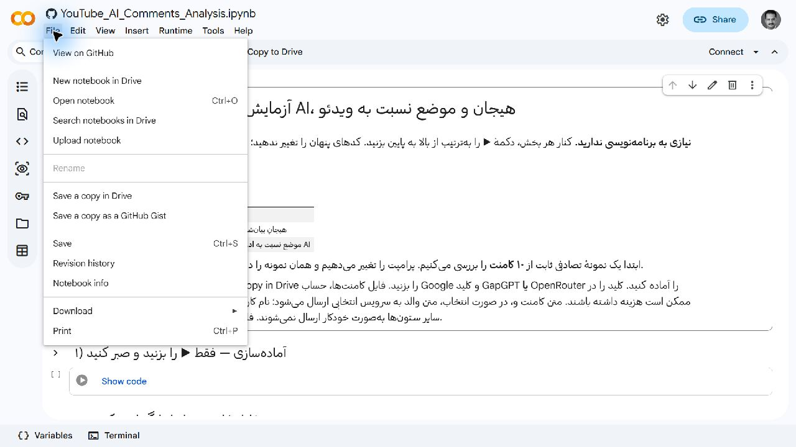
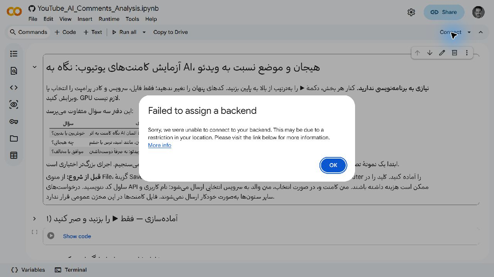
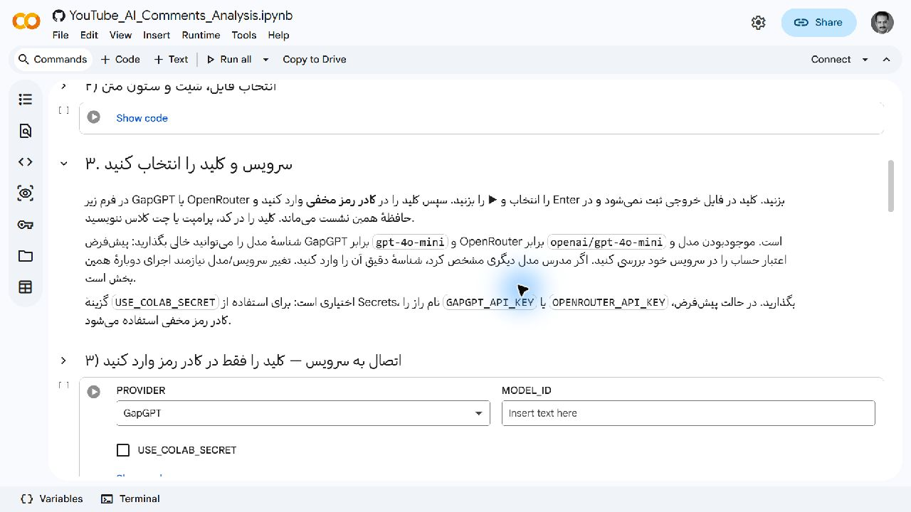
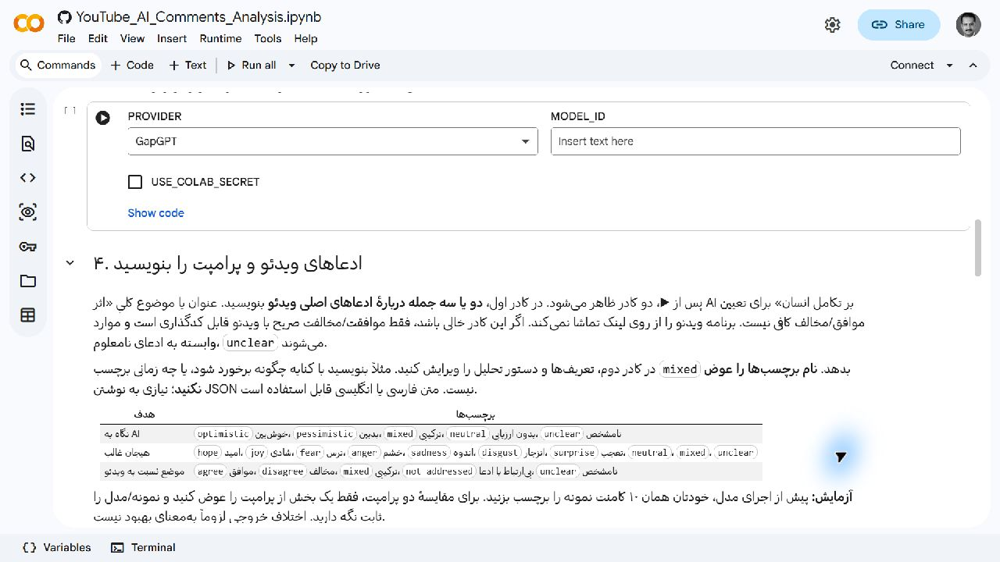

# راهنمای قدم‌به‌قدم آزمایش کامنت‌های یوتیوب در Google Colab

این راهنما برای دانشجویانی است که برنامه‌نویسی بلد نیستند. در این آزمایش، فایل کامنت‌ها را خودتان بارگذاری می‌کنید، سه سؤال را با یک مدل زبانی بررسی می‌کنید، پاسخ‌ها را می‌خوانید و سپس پرامپت را عوض می‌کنید تا ببینید خروجی چطور تغییر می‌کند.

**خلاصهٔ مهم:** فایل کامنت‌ها داخل دفتر Colab یا مخزن GitHub نیست. QR یا لینک فقط دفتر را باز می‌کند. برای اجرای آزمایش باید یک فایل کامنتِ مجاز و یک کلید API از GapGPT یا OpenRouter داشته باشید. اگر فایل داده را ندارید، از مدرس بپرسید؛ فایل دیگری را جایگزین نکنید.

[باز کردن دفتر آزمایش در Colab](https://colab.research.google.com/github/rajabzadehalidip/persian-headline-sentiment-topic-colab/blob/main/YouTube_AI_Comments_Analysis.ipynb)

## قبل از شروع

این موارد را آماده کنید:

1. حساب Google برای استفاده از Colab و ذخیرهٔ نسخهٔ شخصی دفتر.
2. فایل کامنت‌ها با یکی از قالب‌های Excel (`.xlsx`)، CSV، TSV، JSON، JSONL یا TXT. در فایل جدولی، هر ردیف باید یک کامنت باشد و یک ستون باید متن کامنت را نگه دارد.
3. دسترسی و اعتبار API در GapGPT یا OpenRouter. استفاده از API ممکن است هزینه یا محدودیت حساب داشته باشد.
4. دو یا سه جمله که ادعاهای واقعی و اصلی ویدئو را توضیح دهد. دفتر ویدئو را از روی لینک تماشا نمی‌کند.

در این مخزن عمومی، فایل کامنت‌های ویدئو، نام کاربران، کلید API و نتیجهٔ اجرای واقعی منتشر نشده‌اند. نام کاربری و ستون‌های دیگر فایل به مدل فرستاده نمی‌شوند؛ متن کامنت و در صورت انتخاب، متن کامنت والد به سرویس مدل انتخابی فرستاده می‌شود. از فایل‌هایی استفاده کنید که اجازهٔ پردازش آن‌ها را دارید.

## ۱. دفتر را باز کنید و نسخهٔ شخصی بسازید

از لینک بالا یا QR روی اسلاید وارد Colab شوید. تصویر زیر از رابط واقعی Google Colab و دفتر قرارگرفته در GitHub گرفته شده است.

از نوار بالا **File → Save a copy in Drive** را انتخاب کنید. این کار یک نسخهٔ شخصی در Google Drive شما می‌سازد تا بتوانید آن را اجرا کنید. این کار دادهٔ کامنت را دانلود یا به دفتر اضافه نمی‌کند.

اگر صفحهٔ ورود Google دیدید، وارد حساب خود شوید. نسخهٔ شخصی را در Drive پیدا کنید و همان نسخه را ادامه دهید.

## ۲. به محیط اجرا وصل شوید

در گوشهٔ بالا سمت راست **Connect** را بزنید و برای اتصال چند لحظه صبر کنید. وقتی وصل شد، دکمه معمولاً وضعیت اتصال یا مصرف RAM/Disk را نشان می‌دهد. برای این آزمایش GPU لازم نیست.

گاهی Colab در بعضی شبکه‌ها یا مناطق نمی‌تواند محیط اجرا اختصاص دهد. در زمان تهیهٔ این راهنما، Colab واقعاً پیام **Failed to assign a backend** را نشان داد و گفت این خطا ممکن است به محدودیت منطقه مربوط باشد. این پیام خطای کد، فایل یا کلید API شما نیست؛ تا وقتی Colab متصل نشده است، سلول‌ها اجرا نمی‌شوند. بعداً دوباره امتحان کنید یا از مدرس بخواهید روش دسترسی مجاز و پشتیبانی‌شده را پیشنهاد کند. تنظیمات امنیتی شبکه را تغییر ندهید.

## ۳. بخش آماده‌سازی را اجرا کنید

دفتر را از بالا به پایین پیش ببرید. هر بخش یک سلول کد با دکمهٔ گرد **▶** در سمت چپ دارد. روی ▶ همان سلول کلیک کنید و صبر کنید تا اجرای آن تمام شود. لازم نیست کد را باز کنید یا تغییر دهید. سلول‌های متنی فقط راهنما هستند و دکمهٔ اجرا ندارند.

در بخش **۱) آماده‌سازی**، ▶ را بزنید. نخستین اجرا ممکن است چند دقیقه بسته‌ها را نصب کند. تا وقتی علامت اجرا متوقف نشده، همان سلول را چندبار اجرا نکنید. پیام آماده‌شدن را در خروجی زیر سلول بخوانید.

**اگر پیام اتصال Colab را دیدید،** ابتدا مشکل اتصال را حل کنید؛ اجرای دوبارهٔ سلول به‌تنهایی محیط اجرا ایجاد نمی‌کند.

## ۴. فایل خودتان را بارگذاری و ستون متن را انتخاب کنید

در بخش **۲. فایل کامنت‌ها را بارگذاری کنید**، ▶ را بزنید. پنجرهٔ انتخاب فایل باز می‌شود. فایل کامنت‌ها را از رایانه انتخاب کنید و بارگذاری را تأیید کنید. این بارگذاری در نشست Colab شما انجام می‌شود؛ فایل به مخزن GitHub اضافه نمی‌شود.

دفتر یک پیش‌نمایش نشان می‌دهد. این سه مورد را بررسی کنید:

1. متن پیش‌نمایش واقعاً کامنت است، نه نام کاربر، پیوند یا شناسه.
2. اگر فایل Excel است، شیت درست را انتخاب کنید.
3. از فهرست ستون متن، ستونی را انتخاب کنید که متن کامنت در آن است. ستون والد اختیاری است و باید متن کامنت والد باشد، نه شناسهٔ آن.

برای فایل TXT هر خط یک کامنت شمرده می‌شود. اگر کامنت‌ها چندخطی‌اند، از CSV یا Excel استفاده کنید. دکمه‌ها و فهرست‌ها پس از اجرای سلول در خروجی آن ظاهر می‌شوند.

سلول انتخاب فایل پس از اجرا دکمهٔ بارگذاری و فهرست‌های شیت/ستون را در خروجی خودش نشان می‌دهد. چون اتصال Colab در زمان ثبت تصویر برقرار نشد، پنجرهٔ انتخاب فایل و پیش‌نمایش داده قابل ثبت نبود.

## ۵. سرویس و مدل را انتخاب کنید و کلید را محرمانه وارد کنید

در بخش **۳. سرویس و کلید را انتخاب کنید**، سرویس **GapGPT** یا **OpenRouter** را انتخاب کنید و ▶ را بزنید. شناسهٔ مدل را می‌توانید خالی بگذارید تا پیش‌فرض همان سرویس به کار رود. اگر مدرس مدل مشخصی داده، شناسهٔ دقیق را وارد کنید.

کلید API را فقط در کادر رمز مخفی وارد کنید و Enter بزنید. کلید را در کد، پرامپت، فایل خروجی، اسلاید یا پیام گروه ننویسید و از آن عکس نگیرید. گزینهٔ Colab Secrets اختیاری است؛ برای شروع، کادر رمز پیش‌فرض ساده‌تر است. کلید در فایل نتیجه ذخیره نمی‌شود و برای همین نشست در حافظه می‌ماند.

مدل پیش‌فرض GapGPT برابر `gpt-4o-mini` و مدل پیش‌فرض OpenRouter برابر `openai/gpt-4o-mini` است. موجودبودن مدل، دسترسی حساب و هزینه را در سرویس خود بررسی کنید. درخواست‌های آزمایشی واقعی به سرویس بیرونی فرستاده می‌شوند و ممکن است هزینه داشته باشند.

## ۶. ادعاهای ویدئو و پرامپت را تنظیم کنید

در بخش **۴. ادعاهای ویدئو و پرامپت را بنویسید**، ▶ را بزنید. دو کادر ظاهر می‌شود:

1. در کادر ادعاهای ویدئو، دو یا سه جمله دربارهٔ ادعاهای اصلی ویدئو بنویسید. موضوع کلی «اثر AI بر آیندهٔ انسان» برای تشخیص موافقت یا مخالفت کافی نیست. مدل نباید ادعای ویدئو را حدس بزند.
2. کادر پرامپت، دستور تحلیل مدل است. متنش را تغییر دهید تا آزمایش کنید تعریف برچسب‌ها یا دستورها چگونه نتیجه را تغییر می‌دهد. نام برچسب‌های مجاز را نگه دارید و قالب ساختاری را حذف نکنید.

پیش از دیدن جواب مدل، نمونهٔ ۱۰تایی انسانی را دانلود و خودتان برچسب‌گذاری کنید. دکمهٔ فارسی **دانلود نمونه برای برچسب انسانی** در همین بخش است. این کار یک مرجع انسانی کوچک می‌سازد تا پاسخ‌ها را با چیزی بیش از حس کلی مقایسه کنید.

## ۷. اول فقط پایلوت ۱۰تایی را اجرا کنید

در بخش **۵. پایلوتِ ۱۰ کامنت را اجرا و بررسی کنید**، ▶ را بزنید. دفتر برای هر یک از ۱۰ کامنت نمونه یک درخواست مدل می‌فرستد تا هر سه هدف را برچسب بزند. پاسخ‌ها ممکن است کمی طول بکشند.

سه هدف را با هم اشتباه نگیرید:

| سؤال | چه چیزی برچسب می‌خورد؟ | برچسب‌های اصلی |
|---|---|---|
| خوش‌بینی یا بدبینی | نگاه کامنت به اثر AI بر آیندهٔ انسان | `optimistic`, `pessimistic`, `mixed`, `neutral`, `unclear` |
| تشخیص هیجان | هیجانی که در متن کامنت بیان شده | `hope`, `joy`, `fear`, `anger`, `sadness`, `disgust`, `surprise`, `neutral`, `mixed`, `unclear` |
| موافقت یا مخالفت | موضع کامنت نسبت به ادعاهای خود ویدئو | `agree`, `disagree`, `mixed`, `not_addressed`, `unclear` |

مثلاً ممکن است کسی از هوش مصنوعی بترسد ولی با هشدار ویدئو موافق باشد. این دو برچسب تناقض ندارند؛ دربارهٔ دو سؤال متفاوت‌اند.

برای هر پاسخ، برگهٔ خروجی را بخوانید: برچسب، دلیل کوتاه، عبارت شاهد و پرچم `needs_review`. `unclear` یعنی متن برای برچسب مطمئن کافی نیست؛ خطای API نیست. `api_error` یا `invalid_output` پاسخ معتبر برچسب‌گذاری‌شده محسوب نمی‌شود. نمودارهای پایلوت فقط فراوانی برچسب‌های مدل را نشان می‌دهند، نه دقت و نه نظر همهٔ مردم.

## ۸. پرامپت را تغییر دهید و همان نمونه را مقایسه کنید

برای آزمایش اثر پرامپت، فقط یک چیز را در کادر پرامپت بخش ۴ تغییر دهید؛ مثلاً توضیح «کنایه» یا شرایط استفاده از `mixed`. مدل، فایل، ستون و نمونه را ثابت نگه دارید. سپس فقط سلول بخش ۵ را دوباره اجرا کنید.

نمونهٔ پایلوت با بذر ثابت انتخاب می‌شود تا دو پرامپت روی همان ۱۰ کامنت مقایسه شوند. در بخش مرور، دو اجرا را انتخاب و **مقایسهٔ A و B** را بزنید. جدول می‌گوید چند برچسب عوض شده‌اند؛ به‌تنهایی نمی‌گوید کدام نسخه درست‌تر است. برای داوری، به برچسب انسانی و متن واقعی کامنت برگردید.

اگر هیچ تنظیمی عوض نشده باشد، دفتر پاسخ‌های قبلی همین نشست را دوباره به کار می‌گیرد تا هزینهٔ تکراری ندهید. این پاسخ ذخیره‌شده، اجرای مستقل تازه‌ای نیست.

## ۹. نتایج را مرور و دانلود کنید

پس از اجرا به بخش **۷. مرور، دانلود و مقایسه** بروید و ▶ را بزنید تا فهرست اجراها تازه شود. اجرا را انتخاب کنید، ردیف‌های مشکوک را بازبینی کنید و از دکمهٔ **دانلود نتیجهٔ این اجرا (ZIP)** استفاده کنید. ZIP شامل فایل‌های نتیجه و گزارش JSON اجرا است؛ گزارش JSON نسخهٔ پرامپت، تنظیمات و پاسخ‌های خام را برای بازبینی ثبت می‌کند.

پیش از بستن یا راه‌اندازی دوبارهٔ نشست Colab، نتیجه را دانلود کنید. راه‌اندازی مجدد نشست حافظه و فایل‌های موقت را پاک می‌کند. نتیجه را در یک مسیر شخصی نگه دارید و کلید API را همراه آن به اشتراک نگذارید.

## ۱۰. فقط بعد از ارزیابی، کار را بزرگ‌تر کنید

اجرای بزرگ‌تر اختیاری است و در حالت پیش‌فرض خاموش است. قبل از آن:

1. خطاهای فنی پایلوت را برطرف کنید.
2. پاسخ‌های پایلوت را با برچسب‌گذاری انسانی بررسی کنید.
3. موارد اختلاف و خطا را مرور کنید و در صورت نیاز پرامپت را اصلاح کنید.
4. برای سنجش نهایی، از نمونهٔ انسانی تازه‌ای استفاده کنید که برای تغییر پرامپت ندیده‌اید.
5. هزینه و محدودیت حساب را بررسی کنید.

بخش اجرای بزرگ‌تر با حد اولیهٔ ۱۰۰ کامنت و گزینهٔ `RUN_ALL_ROWS` خاموش شروع می‌شود. فقط پس از بازبینی انسانی و آگاهی از هزینه، چک‌باکس تأیید را بزنید و اجرا کنید. انتخاب تمام ردیف‌ها می‌تواند زمان و هزینه را زیاد کند. اگر پرامپت یا مدل را عوض کردید، دوباره پایلوت بگیرید. هیچ تضمینی نیست که مدل روی همهٔ ردیف‌ها درست عمل کند.

## اگر اجرا نشد

- **Failed to assign a backend:** Colab محیط اجرا نداده است؛ این خطای API یا کد نیست. بعداً دوباره امتحان کنید یا از مدرس راهنمایی بگیرید.
- **401 یا 403:** کلید، سرویس یا دسترسی مدل را بررسی کنید.
- **402:** اعتبار یا محدودیت هزینهٔ حساب را بررسی کنید.
- **مدل پیدا نشد:** شناسهٔ دقیق مدل را از سرویس انتخابی بررسی کنید. در OpenRouter نام مدل معمولاً پیشوند شرکت دارد.
- **429 یا وقفه:** ممکن است محدودیت درخواست یا قطعی موقت باشد. پس از کمی صبر دوباره امتحان کنید.
- **متن فارسی ناخوانا:** فایل CSV را با UTF-8 ذخیره کنید یا نسخهٔ Excel را بارگذاری کنید.
- **فهرست‌ها یا کادرها ظاهر نشدند:** ابتدا از اجرای کامل سلول قبلی مطمئن شوید، سپس سلول همان بخش را دوباره اجرا کنید.
- **توقف وسط اجرا:** سلول را متوقف و بخش مرور را برای دیدن نتایج تکمیل‌شده اجرا کنید؛ پیش از پایان نشست، ZIP را دانلود کنید.

## آیا دادهٔ ۲٬۰۰۰ تیتر هم در Colab است؟

این پرسش به آزمایش تیترهای فارسی مربوط است، نه آزمایش کامنت‌ها. فایل ۲٬۰۰۰ تیتر و قالب خالی ۱۰۰تایی در مخزن GitHub قرار دارند و از لینک‌های README قابل دانلودند. خود دفتر تیترها هم هنگام اجرا فایل‌ها را خودکار دریافت نمی‌کند؛ دانشجو باید هر دو فایل را از بخش Files دانلود و در سلول بارگذاری Colab انتخاب کند. فایل ۱۰۰تایی هنوز برچسب مرجع نیست: دانشجویان ابتدا آن را مستقل برچسب می‌زنند و سپس دربارهٔ اختلاف‌ها به اجماع می‌رسند.

پس QR فقط درِ ورودی دفتر است. برای آزمایش کامنت‌ها، فایل کامنت‌ها باید جداگانه از مدرس/منبع مجاز تهیه و بارگذاری شود. برای آزمایش تیترها، داده داخل مخزن است اما باید جداگانه دانلود و به دفتر بارگذاری شود.
